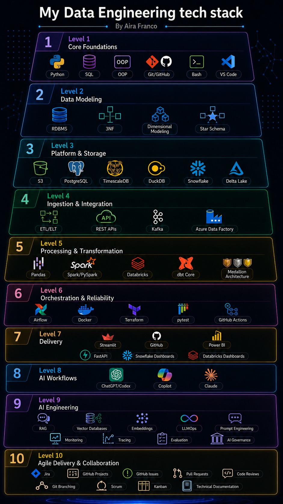

<!-- Banner -->
<!-- ========================================================= -->
<!-- 🚨 DEFINITELY NOT A SUSPICIOUS BUTTON 🚨 -->
<!-- ========================================================= -->

### 🚨 READER DETECTED 🚨

  

  

 

  <strong>Welcome to my GitHub profile — where I document my Data Engineering journey, projects, and experiments.</strong>

 

  

 

## 🐍 Keep on coding to feed my Python Pet

 

## ✍️ Random Dev Quote

 

## 🚀 Projects & Highlights

| Repository | Description |
| :--- | :--- |
| [✈️ Flight Punctuality Swedavia](https://github.com/indiramahadiva/Flight-punctuality_4_DE25) | Modern data stack for analysing flight delays at Swedish airports: dlt, Snowflake, dbt, Dagster and Streamlit, deployed on Azure. |
| [🌟Data Warehouse Lifecycle](https://github.com/Akina-Aoki/AiraTheSnowFairy) | Modern Data Stack Lectture Repo: dlt, dbt, dagster, snowflake, python, azure, streamlit. |
| [🌒 eClipseBord – Azure Full-Stack Application](https://github.com/Akina-Aoki/azure_python_fullstack_lab) | A solar and lunar eclipse app with FastAPI and Streamlit. I used Docker to package it and learned to deploy it to Azure, first manually and then with Terraform. |
| [🏃 Marathos Atlas](https://github.com/Akina-Aoki/marathos_databricks) | My project for learning Medallion Architecture in Databricks. I used PySpark and Lakeflow to take ultramarathon data through bronze, silver, and gold layers and into a dashboard. |
| [⚙️ Product Finder](https://github.com/Akina-Aoki/Product_Finder) | An inventory management project where I worked with ETL, FastAPI, Kafka, and PostgreSQL/Supabase to connect the data pipeline with an application. |
| [💜 European Labour Market Statistics](https://github.com/Akina-Aoki/euro-labor-pulse.git) | A hackathon project exploring European labour market data using DAIS and Lovable. [Open the dashboard](https://euro-labor-pulse.lovable.app/) |
| [🎞️ Streamly](https://github.com/Akina-Aoki/Netflix_Streamlit_Aira) | A Streamlit app where I explored Netflix Top 10 data and practiced turning it into interactive visualizations. [Open the app](https://netflix-top10-tudum-analysis.streamlit.app/) |
| [🪠 My Humble ETL Pipeline](https://github.com/Akina-Aoki/data_ops_workflow_lab1) | My practice with extracting and transforming data using Pandas, then loading it into PostgreSQL with Psycopg 3. |
| [🏫 School System Data Model](https://github.com/Akina-Aoki/data_modelling_lab_aira_franco.git) | A school database project where I practiced relational database design and normalization up to 3NF, using PostgreSQL and Docker. |
| [🦆 Sakila Evidence Dashboard](https://github.com/Akina-Aoki/sql_lab1_aira_franco.git) | My SQL practice with the Sakila database, using DuckDB and Pandas to explore the data and present it in an Evidence dashboard. |
| [🧮 Object-Oriented Programming with Python](https://github.com/Akina-Aoki/aira_franco_lab2.git) | My Python OOP lab, where I practiced organizing code into classes and understanding how objects work together. |

## ✍️ Technical Writing

| Article | Description |
| :--- | :--- |
| [🌟 My Data Engineering Blog](https://hashnode.com/@Aira) | Where I write about what I’m learning, the projects I’m working on, and the things I’m still trying to understand. |
|  [🎻 Orchestration with Dagster](https://dataengineeringlearning.hashnode.dev/learning-data-orchestration-with-dagster) |  I am learning how to orchestrate with dagster. |
| [🏠 Modern Data Warehouse Lifecycle](https://dataengineeringlearning.hashnode.dev/inside-a-modern-data-warehouse-lifecycle-snowflake-dlt-dbt-and-data-modeling)| Learning log with Snowflake, dlt, dbt, and Data Modeling. |
| [📊 Why Semantic Models Need Strong Data Engineering Principles](https://dataengineeringlearning.hashnode.dev/why-semantic-models-need-strong-data-engineering-principles) | What I learned about Power BI semantic models and why the data behind a dashboard matters just as much as the visuals. |
| [📈 Building Marathos Atlas in Databricks](https://dataengineeringlearning.hashnode.dev/marathos-atlas-building-a-data-platform-in-databricks-to-learn-medallion-architecture) | How I built Marathos Atlas to understand Medallion Architecture by actually working through the different data layers. |

 

## 🗺️ My Data Engineering Toolbox

## 📊 GitHub Analytics

<table align="center">
  <tr>
    <td align="center" width="50%">
      
    </td>
    <td align="center" width="50%">
      
    </td>
  </tr>
</table>

 

## Others
- 🗻 Enjoys hiking mountains — the higher, the better
- 🏂 Snowboarding in powder, preferably off-piste
- ⛺ Camping by the beach
- ☕ Good roasted coffee
- 🍜 Cooking and sharing food
- 👩🏻‍💻 Always learning. Keep on going.

